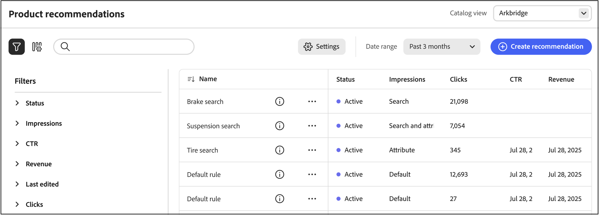
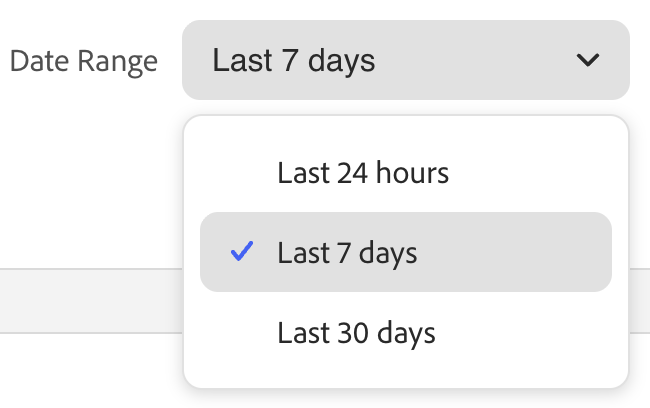

「Recommendations Performance」ページには、設定された推奨事項のリストと、その有効性を評価するのに役立つ主要な指標が表示されます。 過去の日、週、または月の指標を表示するようにビューを設定できます。 こうしたインサイトにより、各レコメンデーションユニットが閲覧またはクリックされる頻度が示され、パフォーマンスを評価し、最適化の機会を特定するのに役立ちます。

>[!INFO]
>
>レコメンデーションユニットは、推奨製品&#x200B;_個のアイテム_&#x200B;を含むウィジェットです。

{zoomable="yes"}

## レポートを読む

1. レコメンデーションが適用される&#x200B;*すべてのビュー*&#x200B;など、**カタログビュー**&#x200B;を選択します。

   レコメンデーションの[ カタログビュー](#select-catalog-view)の詳細をご覧ください。

1. **[!UICONTROL Date Range]**&#x200B;をクリックし、次のいずれかの範囲を選択します。

   

   レコメンデーションテーブルが更新され、その日付範囲とカタログビューの指標が表示されます。

## テーブルをカスタマイズ

1. 左上隅の アイコンをクリックして、テーブルをカスタマイズします。

   表示されている列にはチェックマークが付いています。

1. メニューで、次のいずれかの操作を行います。

   - 非表示の列を表示するには、チェックマークを付けずに任意の列名をクリックします。
   - 表示されている列を非表示にするには、チェックマークが付いている任意の列名をクリックします。

   選択した列のみを含めるように、テーブルが更新されます。

## 詳細を表示

1. テーブルで、確認するレコメンデーションの横にある（） アイコンをクリックします。

1. レコメンデーションのステータスを変更するには、「**アクティブ化**」または「**非アクティブ化**」をクリックします。

## レコメンデーションの作成または管理

[新しいレコメンデーションを作成する方法と、既存の](../merchandising/recommendations/create.md) レコメンデーションを管理する方法について説明します。

## Workspaceコントロール

| 制御 | 説明 |
|---|---|
|  | 指標の計算に使用する時間の範囲を指定します。 |
|  | Recommendations テーブルに表示される列を指定します。 |
| レコメンデーションを作成 | [新しいレコメンデーションの作成](../merchandising/recommendations/create.md) ページを開きます。 |
| [ カタログ ビュー](#select-catalog-view) | カタログ ビューを選択してテーブルをフィルタリングし、選択したカタログ ビューに適用されるレコメンデーションのみを表示します。 この選択範囲は、新しいレコメンデーションを[作成](../merchandising/recommendations/create.md)するときに、カタログビューとしても使用されます。 オプションは&#x200B;*すべてのビュー*&#x200B;または特定の[ カタログビュー](../setup/catalog-view.md)です。 |

## 列の説明

| 列 | 説明 |
|---|---|
| 名前 | レコメンデーションの名前。 |
| ページ | レコメンデーションが表示されるページ。 |
| タイプ | レコメンデーションタイプ。 |
| ステータス | レコメンデーションステータス： オプション：非アクティブ/アクティブ/ドラフト |
| Created | レコメンデーションが作成された日付。 |
| 最終編集日 | レコメンデーションが最後に編集された日付 |
| インプレッション | レコメンデーションユニットがページに読み込まれ、レンダリングされる回数。 買い物客が閲覧していなくても、ブラウザーのビューポートのフォールドの下にあるレコメンデーションユニットが、ページ上にレンダリングされます。 この場合、レンダリングされたユニットはインプレッションとしてカウントされますが、ビューは買い物客がユニットをスクロールして表示する場合にのみカウントされます。 |
| インプレッション | （表示可能インプレッション） 1つ以上のビューを登録するレコメンデーションユニットの数。 たとえば、レコメンデーションユニットに2行があり、それぞれに2つの商品があり、最後の2つの商品が買い物客に表示されないが、最初の2つはインプレッションとしてカウントされる。 |
| ビュー | 買い物客のブラウザーのビューポートに表示されるレコメンデーションユニットの数。 買い物客がページを何度か上または下にスクロールすると、ユニットが表示されるたびにイベントが複数回起動します。 |
| クリック数 | 買い物客がレコメンデーションユニット内の項目をクリックした回数と、買い物客がレコメンデーションユニット内の「**カートに追加**」ボタンをクリックした回数の合計 |
| 収益 | 現在の期間のレコメンデーションによって導かれる収益。 |
| 収益の低下 | （ライフタイム収益） レコメンデーションによって推進されるライフタイム収益。 |
| 視認性 | ビューに登録するレコメンデーションユニットの割合。 |
| CTR | （クリック率） クリックを登録するレコメンデーションの単位インプレッションの割合。 CTRでは、単位が買い物客のビューに入らない場合でも、すべてのインプレッションがカウントされます。 レコメンデーションユニットが表示されない場合、クリックされる可能性は低くなります。 ただし、これらのインプレッションはCTR スコアにカウントされ、CTR全体のパーセンテージが低下します。 |
| vCTR | （表示可能なクリック率）は、表示可能なインプレッション（買い物客の画面の表示部分に実際に表示されたレコメンデーション）にもとづいてクリック数を測定し、より正確なエンゲージメントを提供します。 |

## カタログ ビューを選択

**Recommendations** ページの&#x200B;**[!UICONTROL Catalog view]** セレクターには、次の2つの機能があります。

1. **テーブルをフィルター** – 選択したカタログ ビューに適用されるレコメンデーション （およびその指標）のみを表示します。
1. **新しいレコメンデーションの範囲を設定** - レコメンデーションを[作成](../merchandising/recommendations/create.md)すると、選択したカタログ ビューがユニットの範囲として使用されます。 オプションは&#x200B;*すべてのビュー*&#x200B;または特定の[ カタログビュー](../setup/catalog-view.md)です。

   - **すべてのビュー** – 推奨事項はすべてのカタログビューに適用されます（製品の可用性は引き続きビューごとにフィルタリングされます）。
   - **カタログ ビュー** – 推奨事項は、選択したカタログ ビュー（1つのストアフロント、言語、ブランドなど）にのみ適用されます。

レコメンデーションごとにカタログビューを指定することで、次のことが可能になります。

- すべてのカタログビュー（グローバル）または1つのカタログビューのレコメンデーションを設定します。
- [作成](../merchandising/recommendations/create.md)のレコメンデーションページのカタログビューで商品をプレビューし、フィルタリングします。
- 各ストアフロントで利用可能な商品のみを表示します。
- カタログビューごとに指標とストアフロントの行動を表示します。

### カタログ ビューで製品をフィルタリングする方法

商品の可用性は、**すべてのビュー**&#x200B;の選択範囲の下にあるレコメンデーションユニットに対しても、カタログビューごとに適用されます。 これは、レコメンデーションユニットで設定した[包含または除外フィルター](../merchandising/recommendations/filters.md)に加えて機能します。

**例：「すべてのビュー」選択の下に含めるフィルターを含むレコメンデーション**

- **すべてのビュー**&#x200B;の推奨事項には、SKU_ABC、SKU_CDE、SKU_XYZが含まれます。
- **カタログ ビュー：Kingsbluff**&#x200B;はSKU_ABCまたはSKU_CDEを販売できません。 **表示：** SKU_XYZに加えて、Kingsbluffに有効な他のSKUを追加します。
- **カタログ ビュー：Arkbridge**&#x200B;は、含まれているSKUを販売できません。 **表示：** Arkbridgeで許可されているSKUのみ。 使用可能なユニットがない場合、レコメンデーションユニットはそのストアフロントに表示されません。
