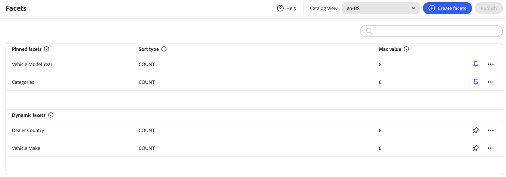

<!--
SOURCE OF TRUTH: Edit this file in the commerce.en repo:
https://github.com/Adobe-Enterprise-Docs/commerce.en/blob/main/help/_includes/ccdm-shared/merchandising/facets/workspace.md

This content is shared by the Adobe Commerce Optimizer Guide (commerce.en) and the
Merchandising Services with CCDM Guide (commerce-admin.en). Changes made in commerce.en
are synced automatically to commerce-admin.en, so do not edit the copy in that repo.
This includes related images in help/assets/ccdm-shared/.
-->

# ファセットWorkspace

*ファセット* ワークスペースには、現在使用可能なすべてのファセットが一覧表示され、ファセットの設定と管理に必要なツールにアクセスできます。 ピン留めされたファセットは、既存のファセットのリストの最初に表示され、次に動的ファセットが表示されます。 ファセットのリストを検索できます。

## フィールドの説明

| フィールド | 説明 |
|--- |--- |
| ファセットの作成 | [&#x200B; ファセットエディター](add.md)を開きます。 |
| ラベル | ストアフロントに表示される[&#x200B; ファセットラベル &#x200B;](type.md#facet-labels)は、ブランドとの一貫性を保つために編集できます。 |
| 並べ替えタイプ | ファセットを[並べ替え](type.md#sort-type)するために使用されるメソッド。 すべてのストアフロントは、ファセットをアルファベット順に並べ替え、`Count`で並べ替えます。 オプション：  アルファベット順 – ファセットをアルファベット順に並べ替えます。 Count – 見つかった一致の数に基づいてファセットを並べ替えます。 |
| 最大値 | 各ファセットのストアフロントに表示できる値の最大数。 値の範囲を表すファセットは均等に分布します。 有効なエントリ：0 ～ 100、デフォルト：8。 |

## コントロール

| 制御 | 説明 |
|--- |--- |
|  | ファセットを&#x200B;*フィルター* リストの先頭にピン留めまたはピン留めを解除します。 |
|  | 選択したファセットに適用できるその他のアクションのメニューを表示します。 オプション：編集、削除 |
