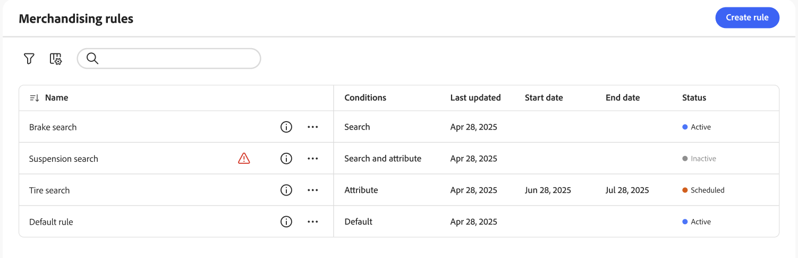

<!--
SOURCE OF TRUTH: Edit this file in the commerce.en repo:
https://github.com/Adobe-Enterprise-Docs/commerce.en/blob/main/help/_includes/ccdm-shared/merchandising/rules/workspace.md

This content is shared by the Adobe Commerce Optimizer Guide (commerce.en) and the
Merchandising Services with CCDM Guide (commerce-admin.en). Changes made in commerce.en
are synced automatically to commerce-admin.en, so do not edit the copy in that repo.
This includes related images in help/assets/ccdm-shared/.
-->

# Workspaceのマーチャンダイジングルール

*マーチャンダイジングルール* ワークスペースには、現在のルールの選択とそのステータスが一覧表示され、ルールの作成と管理に必要なツールへのアクセス権が提供されます。 ルールは、すべての[&#x200B; カタログビュー](https://experienceleague.adobe.com/en/docs/commerce/optimizer/setup/catalog-view) （グローバル）または単一のカタログビューにスコープできます。 カタログビュー別にフィルタリングし、カタログビューごとにルールを作成する方法については、[&#x200B; カタログビューを選択](#select-catalog-view)を参照してください。 ワークスペースから次の操作を実行できます。

- ルールの検索
- ルールの詳細の表示
- ルールのアクティベート/アクティベート解除
- ルールの削除
- ルールエディターへのアクセス

ワークスペースには、**[検索抑制ルール &#x200B;](https://experienceleague.adobe.com/en/docs/commerce/optimizer/merchandising/rules/overview#search-suppression-rules)**&#x200B;も含まれています。 同じルール管理コントロールを使用して、これらのルールを編集、スケジュール、有効または無効にします。 クエリ条件を設定して変更を公開するには、[検索抑制ルールの作成と管理](https://experienceleague.adobe.com/en/docs/commerce/optimizer/merchandising/rules/add#search-suppression-rules)を参照してください。 検索抑制ルールのプレビューは表示されません。

## 列の表示/非表示

1. 右上隅の&#x200B;**表示/非表示** 列をクリックします。

1. メニューで、次のいずれかの操作を行います。

   - 非表示の列を表示するには、チェックマークを付けずに任意の列名をクリックします。
   - 表示されている列を非表示にするには、チェックマークが付いている任意の列名をクリックします。

## ステータス別にルールをフィルタリング

1. ストアに多くのルールがある場合、ステータスでルールをフィルタリングして、リストを短縮できます。 デフォルトでは、ルールリストにはすべてのルールが表示されます。

1. 特定のステータス設定を持つルールのみを一覧表示するには、**ステータス**&#x200B;を次のいずれかに設定します。

   - すべて
   - アクティブ
   - 非アクティブ
   - 予定
   - ドラフト

   **条件**、**開始日**、**終了日**、**最終更新日**&#x200B;でフィルタリングすることもできます。

## 詳細を表示

詳細パネルには、ルール名、ステータス、条件とイベント、開始日と終了日、説明、最終編集日が表示されます。 ルールは、詳細パネルで有効、編集、削除できます。

1. *マーチャンダイジングルール* ワークスペースで、表示するグリッド内のルールを見つけ、（）アイコンをクリックします。

   メニューから次のいずれかを実行できます。

   - ルールを編集
   - ルールを削除
   - ルールの有効化/無効化

## ルールを有効または無効にする {#enable-disable-rule}

1. *マーチャンダイジングルール* ワークスペースでルールを検索します。
1. **詳細**&#x200B;を開きます（。..） メニューから「**ルールを有効にする**」または「**ルールを無効にする**」を選択します。 詳細パネルの&#x200B;**Enabled** コントロールを使用することもできます。
1. 更新されたステータスを確認します。 将来の開始日を持つ有効なルールは、その日付までスケジュールされたままになります。

**検索抑制ルール**&#x200B;の場合、ルールを無効にすると、条件を削除することなく、そのルールが一致するクエリをブロックしなくなります。 他のアクティブな抑制ルールでも、これらのクエリをブロックできます。 ルールの条件または日付を変更するには、**編集**&#x200B;を選択して変更を確認し、**保存して公開**&#x200B;をクリックします。

## 列の説明

| 列 | 説明 |
|--- |--- |
| 名前 | ルールの名前。 |
| 最終更新日 | ルールが最後に更新された日付。 |
| 開始日 | スケジュール済みルールの開始日。 |
| 終了日 | スケジュールされたルールの終了日。 |
| ステータス | 色分けされたステータスは、ルールの現在の状態を示します。 グリッドの上にあるステータスコントロールを使用して、ステータス別にルールをフィルタリングします。 値： すべてのステータス – ステータスに関係なくすべてのルールを表示します。  アクティブ（青） – アクティブなルールのみを表示します。  スケジュール済み（オレンジ） – スケジュール済みルールのみを表示します。 非アクティブ （グレー） – 非アクティブなルールのみを表示します。 |

## コントロール

| 制御 | 説明 |
|--- |--- |
| ルールを追加 | [&#x200B; ルールエディター](add.md)を開きます。 |
| カタログビュー | 選択したカタログ ビューに適用されるルールにテーブルをフィルタリングします。 また、[&#x200B; ルールを作成](add.md)する際にもスコープを設定します。 オプション：*すべてのビュー*&#x200B;または特定の[&#x200B; カタログビュー](https://experienceleague.adobe.com/en/docs/commerce/optimizer/setup/catalog-view)。 [&#x200B; カタログ ビューの選択](#select-catalog-view)を参照してください。 |
| ステータス | ルールのリストをステータス別にフィルタリングします。 オプション：すべて、アクティブ、非アクティブ、スケジュール |
|  | グリッドに表示される列を指定します。 オプション：最終更新日、開始日、終了日、ステータス |
| 検索 | フルネームまたは部分一致でルールを検索します。 |
|  | 選択したルールに適用できるその他のアクションのメニューを表示します。 オプション：編集、詳細の表示、削除 |

## ルールの詳細

| フィールド | 説明 |
|--- |--- |
| ステータス | ルールの現在のステータス。 |
| 条件 | ルールに関連付けられている条件を記述する検索クエリ。 |
| 開始日 | ルールが有効になる日付（スケジュールされている場合）。 |
| 終了日 | スケジュールされた場合、ルールの有効期限が切れる日付。 |
| 説明 | ルールの簡単な説明。 |
| 最終更新日 | ルールが最後に更新された日時。 |
| 有効 | ルールのステータスを変更するコントロール。 オプション：有効/無効 |

## カタログ ビューを選択

マーチャンダイジングルールページの&#x200B;**[!UICONTROL Catalog view]** セレクターには、次の2つの機能があります。

1. **テーブルをフィルター** – 選択したカタログ ビューに適用されるルール （およびその詳細）のみを表示します。
1. **新しいルールの範囲を設定** - ルールを[作成](add.md)すると、選択したカタログ ビューがルールの範囲として使用されます。 オプションは&#x200B;*すべてのビュー*&#x200B;または特定の[&#x200B; カタログビュー](https://experienceleague.adobe.com/en/docs/commerce/optimizer/setup/catalog-view)です。

   - **すべてのビュー** - ルールはすべてのカタログ ビューに適用されます。 カタログを使用するすべてのストアフロントで、検索とランキングの動作は同じです。
   - **カタログ ビュー** – このルールは、選択したカタログ ビュー（1つのストアフロント、地域、ディーラー、ブランドなど）にのみ適用されます。 これは、異なるカタログビューで異なるマーチャンダイジングロジックが必要な場合に使用します。

ルールの作成とスコープの設定について詳しくは、[&#x200B; ルールの作成と管理](add.md)を参照してください。

### カタログビューごとにルールを作成する理由

異なるストアフロント、地域、ブランドで異なる検索やランキング行動が必要な場合に、カタログビューごとにルールを作成します。 例：

- **ディーラーまたはディストリビューターネットワーク** – 各ディーラーには独自のカタログビューがあります。ディーラーごとにピン留めされた商品、ブーストされた商品、埋め込まれた商品を異なるものにすることができます。
- **複数地域** - EU、米国、または地域固有のマーチャンダイジングルールを持つ他の地域向けに、個別のカタログビューを提供します。
- **マルチブランド** – 各ブランドには独自のカタログビューがあり、ブランド固有のルール（ブランドごとに異なるデフォルトのランキングやプロモーション済み製品など）が必要です。

[&#x200B; インテリジェントランキング &#x200B;](add.md#intelligent-ranking)を強化する行動データ（最も閲覧されたデータ、最も購入されたデータ、トレンドなど）は、デフォルトではカタログビューごとに計算されます。 そのため、インテリジェントなランキングを使用するルールは、そのカタログビューの買い物客の行動を反映しています。 アカウントに多数のカタログビューがある場合、システムはパフォーマンスを維持するためにグローバルに行動データを集計する場合があります。その場合、トラフィックの多いカタログビューがランキングに影響を与える可能性があり、トラフィックの少ないビューの関連性が低下する可能性があります。 現在の制限については、[制限と境界](https://experienceleague.adobe.com/en/docs/commerce/optimizer/boundaries-limits)を参照してください。

### カタログビューごとにルールを設定する方法

1. *マーチャンダイジングルール* ワークスペースで、**[!UICONTROL Catalog view]** ドロップダウンを使用して、ルールを適用するカタログビューを選択します。
1. **[!UICONTROL Create rule]**&#x200B;をクリックします。

   作成するルールは、選択したカタログ ビューに対してスコープが設定されます。
1. [&#x200B; ルールエディター](add.md)でルールを作成します。

   エディターで、ルールタイプに適用される条件、イベント、詳細を定義します。 検索抑制ルールでは、クエリ条件を使用して、選択したカタログビュー内の結果のみをブロックします。 カテゴリーナビゲーション、マーチャンダイジングページ、レコメンデーション、製品のURLを通じて、製品の可視性を変更することはありません。

ルールを作成した後で、ルールのカタログ ビュー（スコープ）を変更することはできません。 類似したロジックを別のカタログビューに適用するには、新しいルールを作成し、作成する前にそのカタログビューを選択します。
