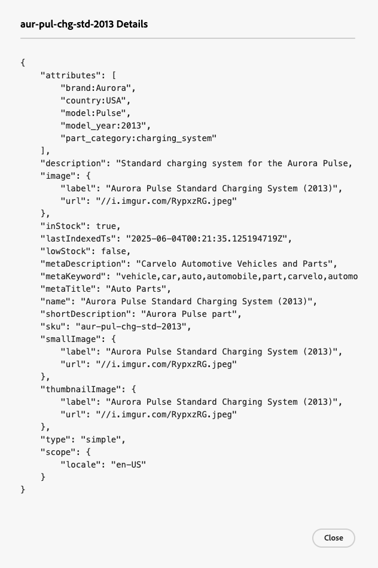

**Data Sync** ページには、データソース（既存のCommerce カタログ、Product Information Management （PIM） システム、Enterprise Resource Planning （ERP） システムなど）からMerchandising Services データレイヤーに転送された製品データの同期ステータスの概要が表示されます。

**データ同期** ページは、ストアフロントの商品データの可用性に関する貴重なインサイトを提供し、買い物客に迅速に表示できるようにします。

## データ同期ワークスペースへのアクセス

*データ同期* ワークスペースを開く方法は、使用する製品によって異なります。

- **Adobe Commerce管理者** （Adobe Commerce as a Cloud Service） - *ストア* > **カタログ同期**&#x200B;を選択します。
- **Adobe Commerce Optimizer Studio**— *Store setup* > **Data Sync**&#x200B;を選択します。

**データ同期** ページには、次のフィールドが含まれています。

| フィールド | 説明 |
| --- | --- |
| カタログソース | 同期データの特定のロケール。 |
| [!DNL Catalog Service] | 最新の同期更新、受信した合計製品、検索フィールド、および[!DNL Catalog Service]の同期製品のテーブルを表示します。 |
| 製品の発見 | 最新の同期更新、受信した合計製品、検索フィールド、および同期済み製品のテーブルを検索用に表示します。 |
| 推奨事項 | 最新の同期更新、受信した製品合計、検索フィールド、およびRecommendations用の同期済み製品のテーブルが表示されます。 |
| 過去3時間以内に受け取った商品 | 過去3時間以内にカタログソースからマーチャンダイジングサービスデータレイヤーに転送された製品の数を表示します。 カタログの更新頻度が低い場合、この値は頻繁にゼロになります。 |
| カタログ内の合計製品数 | マーチャンダイジングサービスのデータレイヤーで使用可能なカタログ製品の合計数を反映します。 |
| 同期済み製品 | マーチャンダイジングサービスのデータレイヤーに同期された製品に関する詳細を提供します。 デフォルトでは、このテーブルは「最終更新日」でソートされます。 特定の製品を検索するには、**[!UICONTROL Search by Name or SKU]** フィールドを使用します。 |

## 同期済み製品のリスト

同期済み製品の詳細をJSON形式で表示するには、同期済み製品テーブルの製品の行にあるコードアイコン をクリックします。

## カタログデータの再同期

**データ同期** ページに特定の製品が表示されない場合は、アップストリームシステムから再同期を開始する必要があります。 ただし、再同期によってハードウェアリソースの負荷が増大する可能性があることに注意してください。 ただし、次のシナリオでは、カタログの再同期が必要になる場合があります。

- 新製品の追加、製品詳細の更新、カテゴリの変更など、製品カタログに大きな変更が加えられた場合

- ストアフロントへの商品データの表示において、矛盾やパフォーマンスの問題が発生した場合

>[!IMPORTANT]
>
>同期を完了するのにかかる時間は、カタログサイズや更新されるデータ量によって異なります。

## データ同期が機能していることを確認します

Adobe Commerceをアップストリームのデータソースとして使用するプロジェクトの場合は、データエクスポートプロセスを監視し、データフィード同期ステータス ページから再同期操作を開始できます。 詳しくは、[ データフィード同期ステータスの監視](https://experienceleague.adobe.com/en/docs/commerce-admin/systems/data-transfer/data-sync/data-feed-sync-status)を参照してください。
