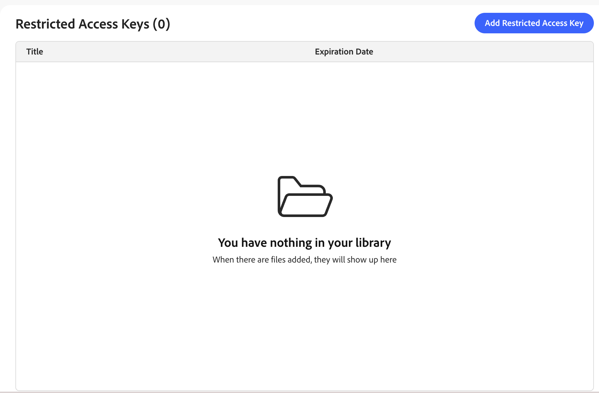

# 制限付きアクセスキー

制限付きアクセスキーを使用すると、許可されたクライアントアプリケーションは[&#x200B; プライベートカタログビュー](private-catalog-view.md)にアクセスできます。割り当てられたキーから有効な署名済みトークンを含むリクエストのみが、カタログデータを取得できます。 このカタログビューへの明示的なアクセス権がない買い物客や、Adobe Commerce Merchandising Services APIを調査するスクリプトなど、その他のすべてのリクエストは拒否されます。

制限付きアクセスキーは、次の2つの方法のいずれかでプロビジョニングされます。

- **自動的に、B2B共有カタログ**&#x200B;の場合：システムは、B2B共有カタログに関連付けられているカタログビューの初期キーをプロビジョニングして割り当てます。 次に、Commerce管理者からキーとキーの割り当てを管理します。 *Commerce管理者ガイド*&#x200B;の「[&#x200B; カタログビュー認証](https://experienceleague.adobe.com/ja/docs/commerce-admin/b2b/shared-catalogs/catalog-views-manage)」を参照してください。 自動プロビジョニングは、次のデプロイメントで使用できます。

  - **Adobe Commerce B2B向けAdobe Commerce as a Cloud ServiceとCCDM**。
  - **Adobe Commerce オンクラウドまたはオンプレミス**&#x200B;は、[!DNL Adobe Commerce Optimizer Connector for B2B]を通じてAdobe Commerce Optimizerと統合されています。 コネクタのB2B拡張機能が必要です。

- **任意のカタログビューに対して手動で** – 自分でカタログビューを保護するには（パートナーポータルやプレリリースプレビューなど）、[制限付きアクセスキーの作成](#create-a-restricted-access-key)から始まるこのトピックの手順に従います。

## 制限付きアクセスキーのユースケース

**[!UICONTROL Price Book ID]**&#x200B;は、リクエストに表示される価格を決定します。これは、リクエストを行うことができる担当者ではなく、価格を指定します。 カタログビューのIDと価格表IDを知っているクライアントは、Merchandising Services APIを通じてそのデータを取得できます。 制限付きアクセスキーは、別個の補完的なコントロールを追加します。各アクセスキーは、どの価格表が適用されるかにかかわらず、カタログビューにまったくアクセスできる範囲を指定します。

制限付きアクセスキーは、一般的に次の目的で使用されます。

- **契約ベースのB2B価格設定** – 交渉済み価格表にリンクされたカタログ ビューを制限して、適用される購入者のみがクエリを実行できるようにします。 その他の購買組織や一般の人は利用できません。 B2B共有カタログの場合は、これが自動的に設定されます。 [&#x200B; キーの管理とローテーション &#x200B;](#key-management-and-rotation)を参照してください。
- **パートナーおよびリセラーポータル**：カタログのサブセットを、マーチャンダイジングサービス APIと直接統合する承認済みパートナーに制限します。
- **プレリリースプレビュー**：信頼できる内部またはパートナーのシステムが公開される前に、今後の製品をプレビューします。

## 制限付きアクセスキーの仕組み

制限付きアクセスキーは、RSA キーペアの公開コンポーネントです。 クライアントアプリケーションは、このキーを生成して使用し、プライベートカタログビューの読み取りが許可されていることを証明します。 このコンテキストでは、_クライアントアプリケーション_&#x200B;は、買い物客を認証するバックエンドシステム（例：[!DNL Adobe Commerce]のカスタムロジックやサードパーティバックエンドなど）を指します。ストアフロントフロントエンド自体は決してありません。

次の手順では、B2B共有カタログに含まれていないカタログビューについて、キーペアと署名済みトークンが作成から検証に移行する方法を説明します。

1. クライアントアプリケーションはRSA鍵ペアを生成し、秘密鍵を保持します。
1. **public** キーを制限付きアクセス キーとしてシステムに登録します。
1. クライアントアプリケーションは、秘密鍵を使用してJSON Web Token （JWT）に署名し、秘密鍵を使用してプライベートカタログビューへの各リクエストに含めます。

   システムは、登録された公開鍵に対してトークンの署名を検証し、有効な場合は、要求されたカタログデータを返します。

## 制限付きアクセスキーのワークスペースへのアクセス

制限付きアクセスキーのワークスペースを開く方法は、使用する製品によって異なります。

- **Adobe Commerce管理者** （Adobe Commerce as a Cloud Service） - *システム* > *データ転送* > **制限付きアクセスキー**&#x200B;を選択します。
- **Adobe Commerce Optimizer Studio** – 「*ストア設定*」 > 「**制限付きアクセスキー**」を選択します。

## 制限付きアクセスキーの作成

>[!NOTE]
>
>この節と後に続くふたつの節では、制限付きアクセスキーを管理するための手動プロセスについて説明します。 自動キープロビジョニング機能を備えたB2B共有カタログの場合は、Commerce管理者からキーを管理します。 [制限付きアクセスキー](https://experienceleague.adobe.com/ja/docs/commerce-admin/systems/data-transfer/data-sync/catalog-view-sync/restricted-access-keys)を参照してください。

### 制限付きアクセスキーの追加

キーの管理に使用するツールのタブ（Commerce管理者またはAdobe Commerce Optimizer Studio）を選択します。

>[!BEGINTABS]

>[!TAB Adobe Commerce管理者]

Adobe Commerce as a Cloud ServiceとCCDM、またはコネクタを介してAdobe Commerceに接続されたAdobe Commerce Optimizerを使用しているお客様は、Commerce管理者からRSA キーペアを生成できます。 [制限付きアクセスキーの管理](https://experienceleague.adobe.com/ja/docs/commerce-admin/systems/data-transfer/data-sync/catalog-view-sync/restricted-access-keys)を参照してください。

>[!TAB Adobe Commerce Optimizer Studio – 手動キー管理]

Adobe Commerce Optimizer Studioを使用しているお客様は、独自のRSA キーペアを生成して管理し、公開鍵をシステムに追加する必要があります。 これは、サードパーティバックエンドを備えたAdobe Commerce Optimizerに必要なワークフローです。 コネクタを使用するお客様は、Commerce管理者の代わりにこのワークフローを使用することもできます。

**RSA キーペアを生成**

プライベートカタログビューの最初のテストでは、[!DNL OpenSSL]などのツールを使用してキーペアを生成します。 秘密鍵は秘密にしておきます。 公開鍵のみが、制限付きアクセス鍵としてシステムにアップロードされます。

```bash
openssl genrsa -out private-key.pem 2048
openssl rsa -in private-key.pem -pubout -out public-key.pem
```

キーサイズは、2048 ビットから8192 ビットの間である必要があります。 `public-key.pem`には、下の&#x200B;**[!UICONTROL Public key]** フィールドに貼り付けた値が含まれています。

**公開鍵をシステムに追加**

1. 制限付きアクセス キーのワークスペースで、**[!UICONTROL Add Restricted Access Key]**&#x200B;をクリックします。

   {width="70%" zoomable="yes"}

1. キーの詳細を入力します。

   {width="70%" zoomable="yes"}

   - **[!UICONTROL Title]** - キーを識別するためのラベル。キーリストおよびカタログ表示のキーピッカー（例：`ACME Corp wholesale portal — Tier 1 pricing`）に表示されます。
   - **[!UICONTROL Expiration date]** – 有効期限がまだ切れていないトークンの場合でも、キーの処理が停止する日時（UTC）。
   - **[!UICONTROL Public key]** - `-----BEGIN PUBLIC KEY-----`および`-----END PUBLIC KEY-----` マーカーを含む、PEMでエンコードされたRSA公開鍵をSubject Public Key Info （SPKI）形式で指定します。 環境全体で一意である必要があります。

1. **[!UICONTROL Save]**&#x200B;をクリックします。

>[!ENDTABS]

キーは作成後に不変になります。 値を変更するには、キーを削除して新しいキーを作成します。 アクセスの中断なしでキー[&#128279;](#rotate-a-key)を回転する方法については、を参照してください。

## カタログビューへのキーの割り当て

アクセス制限キーは、**[!UICONTROL Catalog Protection]**&#x200B;が有効になっているカタログビューに割り当てられた後にのみアクセスを認証します。 設定手順については、[&#x200B; カタログビューの保護](private-catalog-view.md#protect-a-catalog-view)を参照してください。

## キーの削除

1. **[!UICONTROL Restricted access keys]** ワークスペースで、削除するキーを見つけて削除します。

   キーが1つ以上のカタログビューに割り当てられている場合、警告は、そのキーに依存しているクライアントアプリケーションがアクセス権を失うことを説明します。 カタログビュー自体は保護されており、一般に公開されることはありません。

1. 削除を確認します。

## キー管理とローテーション

制限付きアクセスキーは、カタログ保護の使用方法に応じて、次の2つの方法のいずれかで管理されます。

- **自動的に、B2B共有カタログ**—CCDM付きのマーチャンダイジングサービスを使用するAdobe Commerce B2B デプロイメントの場合、および[!DNL Adobe Commerce Optimizer Connector for B2B]を通じて統合されたAdobe Commerce Optimizer デプロイメントの場合（B2B拡張機能が必要）、カタログビューの作成時に、サービスが自動的に最初の制限付きアクセスキーを生成して割り当てます。 各カタログビューには、独自のキーが割り当てられます。 その後、共有カタログまたは会社アカウントページから各キーを管理できます。 また、Commerce管理者&#x200B;**制限付きアクセスキー** ページ（**システム** > **データ転送**）からキーを表示および管理することもできます。 [&#x200B; カタログビュー設定の管理](https://experienceleague.adobe.com/ja/docs/commerce-admin/b2b/shared-catalogs/catalog-views-manage)を参照してください。

  共有カタログとストアビューの組み合わせは、それぞれ別のカタログビューとして表示されます。 プロジェクトとは、カタログ表示、ポリシー、価格表参照、およびアクセス制限キー設定データです。このデータは、その組み合わせのマーチャンダイジングサービスデータレイヤーに書き出されます。 複数のストアビューに割り当てられた共有カタログは、それぞれ独自のキーを持つ複数のカタログビューを生成します。 他のカタログに影響を与えることなく、1つのカタログ ビューのキーを編集または回転します。

  キーのデフォルトは長い有効期限です。 キーを回転させる必要がある場合は、管理画面に置き換えを追加し、古いキーを削除するまで両方をアクティブのままにします。

- **任意のカタログ ビューに対して手動で** - キーの生成および管理方法は、製品のコンテキストによって異なります。 どちらの場合も、買い物客を認証するバックエンドクライアントがトークンに署名します。

  - **Commerce管理者（CCDMを使用するAdobe Commerce as a Cloud Serviceまたはコネクタを使用するAdobe Commerce Optimizer）**:Commerce管理者でRSA キーペアを生成し、**制限付きアクセスキー** ページでキーを作成、割り当て、削除します。 Adobe Commerceでは、キーが自動的に回転しません。 キーを回転するには、[&#x200B; キーの回転](#rotate-a-key)を参照してください。
  - **Adobe Commerce Optimizer Studio** - Studioはキーを生成しません。 これは、サードパーティのバックエンドを備えたAdobe Commerce Optimizerに必要なワークフローであり、コネクタのお客様も使用できます。 クライアントアプリケーションを使用して、RSA キーペアを生成し、秘密鍵を保持し、公開鍵を制限付きアクセスキーとして追加します。 このトピックの前の手順を使用して、キーを作成、追加、削除します。 キーを回転するには、[&#x200B; キーの回転](#rotate-a-key)を参照してください。

### キーの回転

アクセスを中断せずにキーを回転させるには、カタログビューに一度に最大3つのキーを割り当てることができます。

キーの管理に使用するツールのタブ（Commerce管理者またはAdobe Commerce Optimizer Studio）を選択します。

>[!BEGINTABS]

>[!TAB Adobe Commerce管理者]

[&#x200B; キーの選択とローテーション &#x200B;](https://experienceleague.adobe.com/ja/docs/commerce-admin/systems/data-transfer/data-sync/catalog-view-sync/restricted-access-keys#key-selection-and-rotation)を参照してください。 これは、CCDMを使用するAdobe Commerce as a Cloud Serviceと、Adobe Commerce Optimizer コネクタを介してAdobe Commerce Optimizerと統合されたAdobe Commerce プロジェクトに適用されます。

>[!TAB Adobe Commerce Optimizer Studio （手動キー管理） ]

この手順は、サードパーティバックエンドを備えたAdobe Commerce Optimizerで必要です。 コネクタを使用するお客様は、Commerce管理者の代わりにコネクタを使用することもできます。

1. 新しいキーペアを生成し、新しい公開鍵を新しい制限付きアクセス鍵として追加します。
1. 既存のキーと並行して、新しいキーをカタログビューに割り当てます。
1. 新しい秘密鍵で新しいトークンへの署名を開始して、キーロールオーバーを完了します。
1. 新しいキーですべてのクライアントアプリケーションが確認されたら、古いキーを削除して削除します。

>[!ENDTABS]

## 制限

[&#x200B; カタログビューとポリシー制限](https://experienceleague.adobe.com/ja/docs/commerce/optimizer/boundaries-limits)を参照してください。

## その他

- [&#x200B; プライベートカタログビュー](private-catalog-view.md) – アクセスキーが制限されたカタログビューを保護する方法について説明します。
