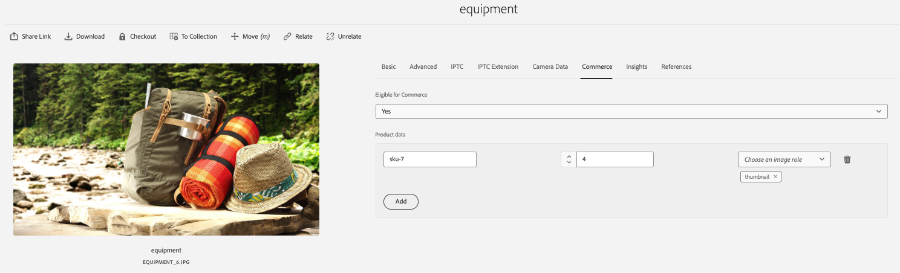

# デフォルトの自動一致

CommerceのAEM Assets統合では、**AEM Assets** メタデータ設定に基づいて、デフォルトの自動一致メカニズム（**[!UICONTROL Match by product SKU]**）が提供されます。 このルールにより、**Adobe Commerce**&#x200B;と&#x200B;**AEM Assets**&#x200B;の間でシームレスに同期が可能になり、アセットが正しいマーチャンダイジングエンティティに自動的にリンクされるようになります。

## 自動マッチングメカニズムの設定

1. Commerce管理者から、**[!UICONTROL Stores]** > **[!UICONTROL Settings]** > **[!UICONTROL Configuration]** > **[!UICONTROL ADOBE SERVICES]** > **[!UICONTROL AEM Assets Integration]**&#x200B;に移動します。

1. 一致するルールとして&#x200B;**[!UICONTROL Match by product SKU]**&#x200B;を指定します。

   {width="700" zoomable="yes"}

1. **[!UICONTROL Match by product SKU attribute name]**&#x200B;に、実際のSKU値ではなく、商品SKUをAEM Assetsに保存する[ メタデータプロパティ名](../metadata.md)を入力します。

   >[!NOTE]
   >
   > 標準オンボーディングプロセスに従った場合、この値は`commerce:skus`に設定する必要があります。

## 自動マッチングメカニズムの仕組み

Commerce Adminで&#x200B;**[!UICONTROL Match by product SKU]**&#x200B;一致ルールが設定されている場合、Commerce アセットファイルは、各ファイルに設定されたアセットメタデータに基づいて、AEM AssetsからCommerce プロジェクトに自動的に同期されます。 メタデータは、**AEM Assets author**&#x200B;環境の「**Commerce**」タブから設定します。

1. AEM Assets オーサーインスタンスを開きます（URLは、Adobe Commerceと同じIMS組織内のプロジェクトにプロビジョニングされます）。

1. メインのナビゲーション画面から、**Assets**&#x200B;をクリックして、デジタルアセット管理（DAM）インターフェイスにアクセスします。

1. AEM Assetsで、`Eligible for Commerce` フィールドを`Yes`に設定して、画像メタデータを更新し、Adobe Commerceの関連付けを追加します。

   {width="600" zoomable="yes"}

1. アセットを関連付けられた製品SKUにリンクするメタデータ （[!UICONTROL SKU]、[!UICONTROL position]、および[!UICONTROL role]）を設定します。

   4つの標準ロールは`image`、`small_image`、`thumbnail`、`swatch_image`です。 AEM Assets Integration拡張機能バージョン 1.4.6以降では、`hero`や`custom_role_1`などのカスタム画像ロールを入力することもできます。 詳しくは、[ カスタム自動一致](custom-match.md)を参照してください。

   >[!NOTE]
   >
   > 1つのアセットが複数の製品に使用されている場合は、関連付けられた各SKUのメタデータを設定します。

1. 「`Basic`」タブで、_[!UICONTROL Review Status]_フィールドのデフォルト値を`approved`に設定します。

   {width="600" zoomable="yes"}

アセットを承認したら、[製品の関連付け、同期結果、およびストアフロント表示を確認します](../get-started/setup-synchronization.md#verify-the-integration)。 アセットが表示されない場合は、[同期ステータス ](../get-started/sync-status.md)を確認してください。 Adobe Commerce Optimizerの場合は、代わりに[Optimizer検証ワークフロー](../get-started/configure-aco.md#match-by-sku-workflow-example)を使用してください。同期ステータスは使用できません。

[!BADGE PaaSのみ]{type=Informative tooltip="Cloud プロジェクト上のAdobe Commerce（Adobeで管理されるPaaS インフラストラクチャ）にのみ適用されます。"}その他の同期のトラブルシューティングについては、[統合ログ ](../get-started/logs.md)を確認してください。
