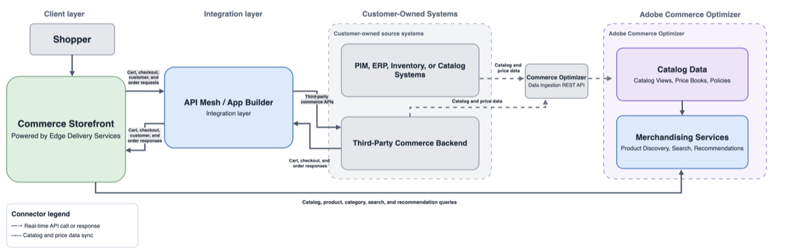

# 実装アーキテクチャオプション

Adobe Commerceの導入アーキテクチャは、コマースバックエンド（[!DNL Adobe Commerce]または[!DNL Adobe Commerce Optimizer]）、ストアフロント、接続されたサービスと統合のセットという3つのレイヤーを組み合わせています。 次のオプションを比較して、各アーキテクチャ内のどのシステムがカタログ、価格設定、カート、チェックアウト、注文、顧客取引を所有しているかを特定します。

## アーキテクチャオプションの概要

トランザクションの所有権とストアフロントのエクスペリエンスごとにオプションを比較します。

### Commerceのプラットフォームとトランザクション

| オプション | 記録システム | トランザクションパス | 最適なフィット |
| --- | --- | --- | --- |
| **[!DNL Adobe Commerce as a Cloud Service]（Commerce Foundation**） | AdobeのCommerce Foundation | Managed Commerce FoundationとコネクテッドCommerceサービス | Adobeを利用して、SaaS （Software as a Service）を実現し、インフラストラクチャの所有権を低減したいCommerce |
| [!DNL Adobe Commerce Optimizer Connector]**を持つクラウドまたはオンプレミスの**[!DNL Adobe Commerce] | 既存のCommerce Foundation, for Commerce データとトランザクション | 既存のCommerce Foundation APIと接続されたトランザクションサービス | 既存の[!DNL Adobe Commerce]展開にOptimizerの検出およびマーチャンダイジング機能を追加したいお客様 |
| **外部コマースバックエンドを持つスタンドアロン [!DNL Adobe Commerce Optimizer]** | 既存またはサードパーティのコマースプラットフォーム： 外部ソースからOptimizerにカタログと価格データが追加される | API Mesh、App Builder、ダイレクト統合を利用して、ストアフロントとサードパーティのカート、チェックアウト、顧客、注文、支払い、税務、配送、フルフィルメントサービスを連携できます | 既存またはサードパーティのトランザクションコマースプラットフォームを維持しながら、Optimizerの機能を必要とするお客様 |
| Commerce Foundation **を使用したクラウドまたはオンプレミスの**[!DNL Adobe Commerce] | Commerce財団 | Commerce Foundation APIと、支払い、税務、配送、在庫、フルフィルメントの統合機能を構成 | クラウドまたはオンプレミスのインフラストラクチャをデプロイメント制御できる完全な[!DNL Adobe Commerce] プラットフォームを必要とするお客様 |

### ストアフロント体験

ストアフロントは、Commerce Foundation API、ストアフロントサービス（[!DNL Catalog Service]、[!DNL Live Search]および[!DNL Product Recommendations]）、または[!DNL Adobe Commerce Optimizer] マーチャンダイジングサービスに接続します。

| オプション | ストアフロント体験 | ストアフロントのデータパス |
| --- | --- | --- |
| **[!DNL Adobe Commerce as a Cloud Service]（Commerce Foundation**） | Edge Delivery Servicesまたはその他のサポートされているヘッドレス体験を活用したCommerce Storefront | ストアフロントサービスに加えて、コアプラットフォームデータ用のCommerce Foundation API |
| [!DNL Adobe Commerce Optimizer Connector]**を持つクラウドまたはオンプレミスの**[!DNL Adobe Commerce] | Edge Delivery ServicesまたはOptimizer エクスペリエンスを使用したカスタムヘッドレスストアフロント | Commerce Optimizer Merchandising Services GraphQL API （Optimizerで管理されるカタログとマーチャンダイジングデータ用） |
| **外部コマースバックエンドを持つスタンドアロン [!DNL Adobe Commerce Optimizer]** | Edge Delivery Servicesまたはカスタムのヘッドレスストアフロントを活用したCommerce Storefront | Commerce Optimizer Merchandising Services カタログおよびマーチャンダイジングデータ用のGraphQL API |
| Commerce Foundation **を使用したクラウドまたはオンプレミスの**[!DNL Adobe Commerce] | Edge Delivery Services、Luma、PWA、またはカスタムヘッドレスストアフロント | Commerce Foundation APIと、設定済みのStorefront サービス |

## Adobe Commerce as a Cloud Service

{width="600" zoomable="yes"}

**主な境界** - AdobeがCommerce Foundation プラットフォームを管理します。 アーキテクチャは、ストアフロント エクスペリエンスに[!DNL Catalog Service]、[!DNL Live Search]、[!DNL Product Recommendations]などのストアフロントサービスを使用します。 AEM Assetsによる[!DNL Product Visuals]は、オプションのSaaS統合です。 Commerce](../aem-assets/aem-assets-integration.md)の[AEM Assetsとの連携を参照してください。

**参照：**

- [[!DNL Adobe Commerce as a Cloud Service] の概要](/help/cloud-service/overview.md)
- [Commerce ストアフロント](https://experienceleague.adobe.com/en/tools/commerce-storefront/)
- [Storefront Services GraphQL スキーマ](https://developer.adobe.com/commerce/webapi/graphql/schema/storefront-services/)

## Adobe CommerceとCommerce Foundation

{width="600" zoomable="yes"}

**主な境界**:Commerce FoundationがCommerce プラットフォームとトランザクションフローを所有します。 [!DNL Catalog Service]、[!DNL Live Search]および[!DNL Product Recommendations]は、設定時に、カタログ、検索、およびレコメンデーションに最適化されたストアフロント アクセスを提供します。 AEM Assetsとの連携はオプションです。 Commerce](../aem-assets/aem-assets-integration.md)の[AEM Assetsとの連携を参照してください。

**参照：**

- [Commerce ストアフロント](https://experienceleague.adobe.com/en/tools/commerce-storefront/)
- [COMMERCE GRAPHQL API](https://developer.adobe.com/commerce/webapi/graphql/)
- [Storefront Services GraphQL スキーマ](https://developer.adobe.com/commerce/webapi/graphql/schema/storefront-services/)

## Adobe CommerceとOptimizer コネクタ

{width="600" zoomable="yes"}

**キー境界** - コネクタは、[!DNL Adobe Commerce]から[!DNL Adobe Commerce Optimizer]までのカタログと価格データを同期します。 [!DNL Adobe Commerce]は引き続きトランザクションシステムであり、OptimizerはMerchandising Services APIを通じて検出およびマーチャンダイジング体験を提供します。

**参照：**

- [Commerce Optimizerとの連携](/help/optimizer/integrations/integrations-overview.md)
- [Commerce Optimizer Merchandising Services](https://developer.adobe.com/commerce/services/optimizer/merchandising-services/)
- [COMMERCE GRAPHQL API](https://developer.adobe.com/commerce/webapi/graphql/)
- [Commerce ストアフロント](https://experienceleague.adobe.com/en/tools/commerce-storefront/)

## サードパーティバックエンドを備えたスタンドアロンのCommerce Optimizer

{width="800" zoomable="yes"}

**主な境界** - スタンドアロン [!DNL Adobe Commerce Optimizer]は、カタログの検索とマーチャンダイジングのエクスペリエンスを所有していますが、トランザクション Commerce バックエンドは所有していません。 カタログと価格データは、Data Ingestion REST APIを使用して入力します。 Edge Delivery Servicesのストアフロントでは、商品エクスペリエンスにGraphQL APIを使用し、カートとチェックアウトの際にサードパーティバックエンドに接続します。

**参照：**

- [Adobe Commerce Optimizerとは？](/help/optimizer/overview.md)
- [Commerce Optimizer Data Ingestion](https://developer.adobe.com/commerce/services/optimizer/data-ingestion/)
- [Commerce Optimizer Merchandising Services](https://developer.adobe.com/commerce/services/optimizer/merchandising-services/)
- [Commerce ストアフロント](https://experienceleague.adobe.com/en/tools/commerce-storefront/)

## 用語クイックリファレンス

| 優先語 | 意味 | 現在のアーキテクチャラベルとして使用することを避ける |
| --- | --- | --- |
| **Commerce Foundation** | ベースコマースとトランザクション機能 | Core Commerce、PHP基盤レイヤー |
| **ストアフロントサービス** | カタログサービス、ライブサーチ、商品レコメンデーション用のストアフロント向けAPI | Commerceの基盤がひとつ限定されているラベル |
| **Commerce Optimizer マーチャンダイジングサービス** | カタログの発見とマーチャンダイジング体験のためのOptimizer API | Commerce Foundation API |
| **Edge Delivery Servicesを活用したCommerce Storefront** | 顧客向けストアフロントの導入 | API ファミリ |

## 関連するガイダンス

- [参照アーキテクチャ](reference-architectures.md)
- [Commerce オプションの選択](../portfolio/choose-commerce-option.md)
- [ストアフロント](../storefronts/overview.md)
- [API](../apis/commerce-apis.md)
